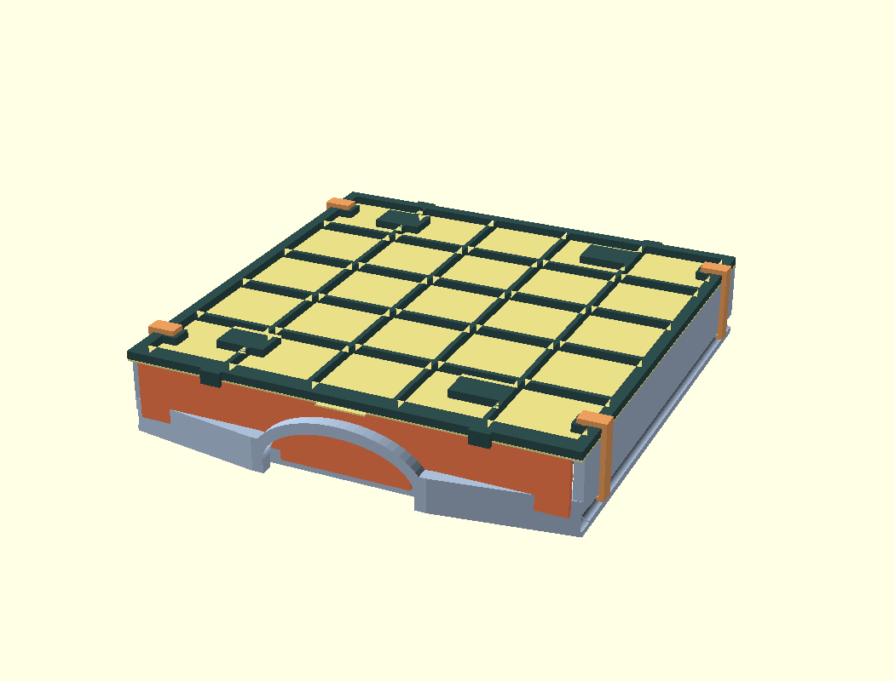

# FAIZ Trussed Cabinet

42 mmピッチのGridfinityを5×5マス収める、オープンバックの4段キャビネット。各ドロワは単独で取り外せる。キャビネットでは背面のタイバーが押し込みを止め、持ち運ぶときは専用の蓋と前面ゲートでドロワを閉じる。

## 印刷する部品

標準寸法の追加部品は[背面タイバーと上下ストッパーのSTL](stl/reinforcements/)と[携行用キットのSTL](stl/transport/)に収録。キャビネットを一式作る場合や寸法を変える場合は、[OpenSCADソース](src/faiz_cabinet.scad)を開く。先頭の `part` に下表の値を指定し、F6でレンダリングしてSTLを書き出す。数量は既定の4段仕様。

| 部品 | `part` | 必要数 |
|---|---|---|
| 側壁 | `left`、`right` | 各1 |
| 天板・底板 | `top`、`bottom` | 各1 |
| ドロワ | `drawer` | 4 |
| 背面タイバー | `tie_bar` | 各段1、計4 |
| 底板の前端ストッパー | `rail_stop_left`、`rail_stop_right` | 左右各1。左右セットは `rail_stops` |
| 天板の前端ストッパー | `top_rail_stop_left`、`top_rail_stop_right` | 左右各1。左右セットは `top_rail_stops` |
| 携行用の蓋・前面ゲート・補強枠 | `drawer_lid`、`lid_front_gate`、`lid_transport_frame` | 携行するドロワ1個につき各1 |
| 携行用ロッククリップ | `lid_lock_clip` | 蓋1枚につき4、すべて同形状 |

組立表示は `assembly`、ドロワ単体の携行状態は `drawer_transport`、蓋をドロワ底面に収納した状態は `drawer_lid_stored`。`drawer_plate` はドロワと210×210 mmの参考プレートを表示する。

## キャビネットの組立

1. ドロワ・天板・底板を外し、左右の後端柱をそれぞれ約3.3 mm内側に寄せる。各段の背面からタイバーを差し、柱を外側へ戻して両端のコの字爪に収める。爪の先はその段の横桟に載る。
2. 天板と底板を側壁の上下に通し、側壁を溝の奥まで収める。背面のタイバーは側壁と同じ厚み4 mm。ドロワを閉じたとき、後壁とタイバーの設計上の隙間は0.30 mm。
3. 上下各板の前端に左右のストッパーを取り付ける。各ストッパーの2本のキーを対応する六角穴へ上から押し込み、先端で天板・底板にある溝の入口をふさぎ、側壁のレールの抜けを止める。外すときはストッパーの台座を持ち上げる。底板側は最下段のドロワを先に抜く。

## ドロワの持ち運びと蓋の収納

1. ドロワを引き抜き、前面ゲートを取っ手と手前の低い壁の間へ上から差し込む。
2. **蓋のスナップ4か所を上向き**にして載せ、その上に補強枠を重ねる。枠の前後の返しはドロワの外側にかかる。
3. 左右2か所ずつ、クリップ上端の突起を枠の長穴に合わせ、下爪をドロワの側溝に掛ける。
4. キャビネットに戻すときは、各クリップの下爪を少し外へ開いて外し、枠・蓋・前面ゲートを外す。蓋だけをドロワの下から当て、4か所のスナップを底面の六角穴へ押し込む。枠・ゲート・クリップは別に保管する。

蓋の底面収納はベースプレートを敷かないドロワ用。収納した爪先はドロワの内側へ約0.5 mm出るので、使うビンの底形状によっては爪に当たる。

## 携行用パーツの材料

室温で使う場合の試作方針。蓋本体には収納用のばね爪が一体になっている。

| 部品 | 材料 |
|---|---|
| 薄い蓋・ロッククリップ | PETG |
| 補強枠・前面ゲート | PLA |

## 嵌合と検証

ばね爪はPETGでの試作を想定。薄い蓋を1枚印刷する前に、`lid_snap_coupon` で実物の底面穴への掛かりと外しやすさを確認できる。レール、プレートのポケット、床のハニカム、天底板の接合にはそれぞれ `rail_coupon`、`plate_coupon`、`honey_coupon`、`panel_joint_coupon` を使う。

標準寸法の追加部品はOpenSCADでレンダリングし、携行時の部品同士の位置関係と、底面に蓋を付けたドロワの引き出し経路を確認した。蓋厚は0.8 mmで、最下段の蓋と底板ストッパーの隙間は設計上0.2 mm。印刷後は空のドロワで反り・摺動・爪の掛かりを確かめる。携行時の保持力や繰り返し脱着に対する耐久性は未測定。
