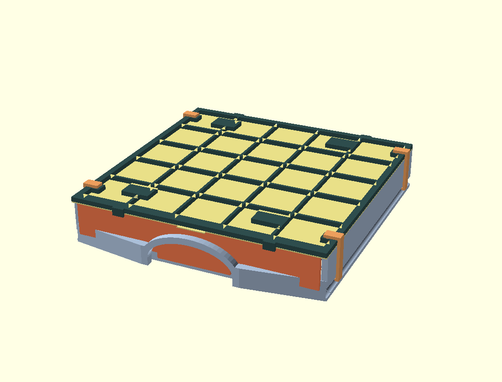
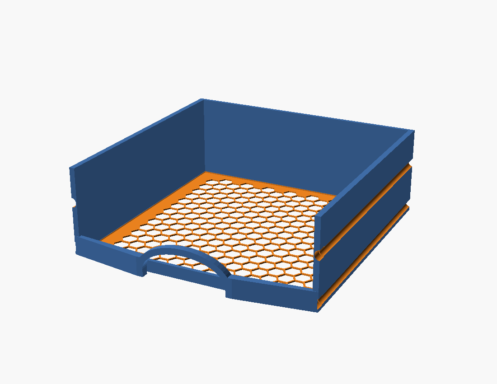
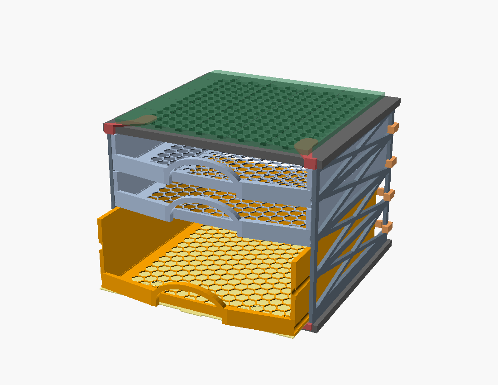
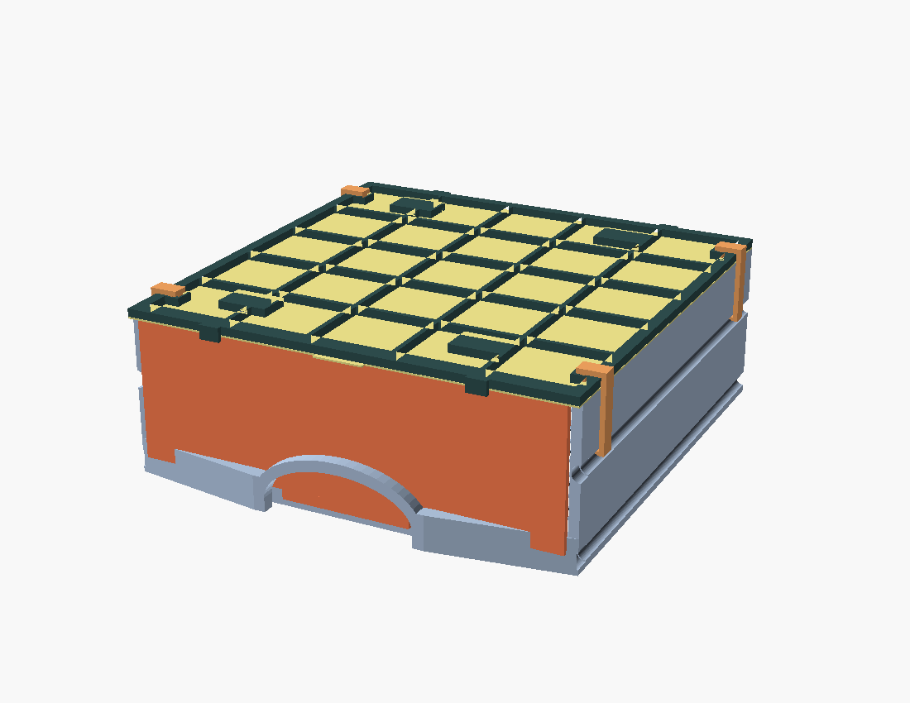

# FAIZ Trussed Cabinet

42 mmピッチのGridfinityを5×5マス収める、オープンバックの4段キャビネット。高さ38 mmの通常ドロワと、2段分を使う高さ78 mmの深型ドロワを組み合わせられる。各ドロワは単独で取り外せる。キャビネットでは背面のタイバーが押し込みを止め、持ち運ぶときは専用の蓋と前面ゲートでドロワを閉じる。

## 印刷する部品

標準寸法の追加部品は[背面タイバーと上下ストッパーのSTL](stl/reinforcements/)と[携行用キットのSTL](stl/transport/)に収録。深型には[ドロワ本体](stl/drawers/drawer_deep.stl)と[専用の前面ゲート](stl/transport/06_front_gate_deep.stl)を使う。キャビネットを一式作る場合や寸法を変える場合は、[OpenSCADソース](src/faiz_cabinet.scad)を開く。先頭の `part` に下表の値を指定し、F6でレンダリングしてSTLを書き出す。数量は既定の4段仕様。

| 部品 | `part` | 必要数 |
|---|---|---|
| 側壁 | `left`、`right` | 各1 |
| 天板・底板 | `top`、`bottom` | 各1 |
| 通常ドロワ | `drawer` | 既定は4。深型と組み合わせる場合は下表を参照 |
| 深型ドロワ | `drawer_deep` | 1個で2段分を使用 |
| 背面タイバー | `tie_bar` | 各段1、計4 |
| 底板の前端ストッパー | `rail_stop_left`、`rail_stop_right` | 左右各1。左右セットは `rail_stops` |
| 天板の前端ストッパー | `top_rail_stop_left`、`top_rail_stop_right` | 左右各1。左右セットは `top_rail_stops` |
| 携行用の蓋・前面ゲート・補強枠 | `drawer_lid`、`lid_front_gate`、`lid_transport_frame` | 携行するドロワ1個につき各1 |
| 深型用の前面ゲート | `lid_front_gate_deep` | 深型を携行する場合に1。通常用ゲートの代わりに使用 |
| 携行用ロッククリップ | `lid_lock_clip` | 蓋1枚につき4、すべて同形状 |

組立表示は `assembly`。ドロワ単体の表示は次の値で切り替える。プレート付きの選択肢には210×210 mmの参考プレートが含まれる。

| 表示 | 通常ドロワ | 深型ドロワ |
|---|---|---|
| 参考プレート付き | `drawer_plate` | `drawer_deep_plate` |
| 携行用パーツを装着 | `drawer_transport` | `drawer_deep_transport` |
| 蓋を底面に収納 | `drawer_lid_stored` | `drawer_deep_lid_stored` |

## 深型ドロワの組み合わせ

深型の高さは通常の38 mmにレール1段分の40 mmを加えた78 mm。幅・奥行・床・手前の低い壁・取っ手は通常型と共通で、側面には底面から7 mmと47 mmの高さに溝がある。上下2段のレールに通して使い、背面タイバーは4本すべて装着する。

手前は通常型と同じ低い壁なので、蓋を付けない状態の前開口も40 mm高くなる。携行時は深型用の前面ゲートで閉じる。

組立表示で使う `drawer_spans` は下から上の順。`1` は通常型、`2` は深型を表す。空の配列 `[]` は全段を通常型にする。

| `drawer_spans` | 下から上への配置 | 必要なドロワ |
|---|---|---|
| `[]` | 通常・通常・通常・通常 | 通常4個 |
| `[2,1,1]` | 深型・通常・通常 | 深型1個、通常2個 |
| `[1,2,1]` | 通常・深型・通常 | 深型1個、通常2個 |
| `[1,1,2]` | 通常・通常・深型 | 通常2個、深型1個 |
| `[2,2]` | 深型・深型 | 深型2個 |

`drawer_count` はキャビネットのレール段数で、既定値は4。`drawer_spans` に値を入れる場合は、その合計を `drawer_count` に合わせる。引き出して表示する `preview_pulled_drawer` は実際のドロワを下から `0`、`1`、…と数える。既定の `-1` は最上段のドロワを選ぶ。

## キャビネットの組立

1. ドロワ・天板・底板を外し、左右の後端柱をそれぞれ約3.3 mm内側に寄せる。各段の背面からタイバーを差し、柱を外側へ戻して両端のコの字爪に収める。爪の先はその段の横桟に載る。
2. 天板と底板を側壁の上下に通し、側壁を溝の奥まで収める。背面のタイバーは側壁と同じ厚み4 mm。ドロワを閉じたとき、後壁とタイバーの設計上の隙間は0.30 mm。
3. 上下各板の前端に左右のストッパーを取り付ける。各ストッパーの2本のキーを対応する六角穴へ上から押し込み、先端で天板・底板にある溝の入口をふさぎ、側壁のレールの抜けを止める。外すときはストッパーの台座を持ち上げる。底板側は最下段のドロワを先に抜く。

## ドロワの持ち運びと蓋の収納

1. ドロワを引き抜き、前面ゲートを取っ手と手前の低い壁の間へ上から差し込む。
2. **蓋のスナップ4か所を上向き**にして載せ、その上に補強枠を重ねる。枠の前後の返しはドロワの外側にかかる。
3. 左右2か所ずつ、クリップ上端の突起を枠の長穴に合わせ、下爪をドロワの側溝に掛ける。
4. キャビネットに戻すときは、各クリップの下爪を少し外へ開いて外し、枠・蓋・前面ゲートを外す。蓋だけをドロワの下から当て、4か所のスナップを底面の六角穴へ押し込む。枠・ゲート・クリップは別に保管する。

深型も同じ蓋・補強枠・4個のクリップを使う。前面ゲートは40 mm高い深型用に交換し、クリップの下爪を**深型の上側の溝**に掛ける。

蓋の底面収納はベースプレートを敷かないドロワ用。収納した爪先はドロワの内側へ約0.5 mm出るので、使うビンの底形状によっては爪に当たる。

## 携行用パーツの材料

室温で使う場合の試作方針。蓋本体には収納用のばね爪が一体になっている。

| 部品 | 材料 |
|---|---|
| 薄い蓋・ロッククリップ | PETG |
| 補強枠・前面ゲート | PLA |

## 嵌合と検証

ばね爪はPETGでの試作を想定。薄い蓋を1枚印刷する前に、`lid_snap_coupon` で実物の底面穴への掛かりと外しやすさを確認できる。レール、プレートのポケット、床のハニカム、天底板の接合にはそれぞれ `rail_coupon`、`plate_coupon`、`honey_coupon`、`panel_joint_coupon` を使う。

標準寸法の追加部品はOpenSCADでレンダリングし、携行時の部品同士の位置関係と、底面に蓋を付けたドロワの引き出し経路を確認した。蓋厚は0.8 mmで、最下段の蓋と底板ストッパーの隙間は設計上0.2 mm。印刷後は空のドロワで反り・摺動・爪の掛かりを確かめる。携行時の保持力や繰り返し脱着に対する耐久性は未測定。

深型本体と深型用ゲートもOpenSCADでレンダリングし、各STLが閉じた一体形状であることを確認した。4段キャビネットの下・中・上の各2段に深型を配置して、全引き出し経路と、蓋を底面収納した状態で側壁・上下板・タイバー・ストッパーに干渉しないことを確認した。隣の通常ドロワとの隙間と、2本のタイバーが深型の後壁に当たることも確認済み。

深型2個の配置と、深型の携行状態も確認した。携行時の部品同士に体積干渉はなく、上側の溝への4個のクリップの掛かり、蓋・枠・ゲートの上下保持と前後のずれ止め、深型ゲートの印刷形状と組立形状の一致を確認した。既存25種の選択肢も前版と比較し、形状が変わっていないことを確認した。

深型は上下2本の溝を同時にレールへ通すため、印刷後に空の状態で全行程の摺動を確認する。深型ドロワと深型用ゲートの実物での嵌合・反り・積載時の保持力は未確認。

## ライセンス

本リポジトリのOpenSCAD設計データ、STL、画像、ドキュメントは、[Creative Commons 表示-継承 4.0 国際（CC BY-SA 4.0）](https://creativecommons.org/licenses/by-sa/4.0/)で提供する。ライセンス全文は[LICENSE](LICENSE)を参照。

クレジット表記例

> [FAIZ Trussed Cabinet](https://github.com/gefox00/faiz-trussed-cabinet) — gefox00（[CC BY-SA 4.0](https://creativecommons.org/licenses/by-sa/4.0/)）

変更して再配布する場合は、変更内容も記載する。
